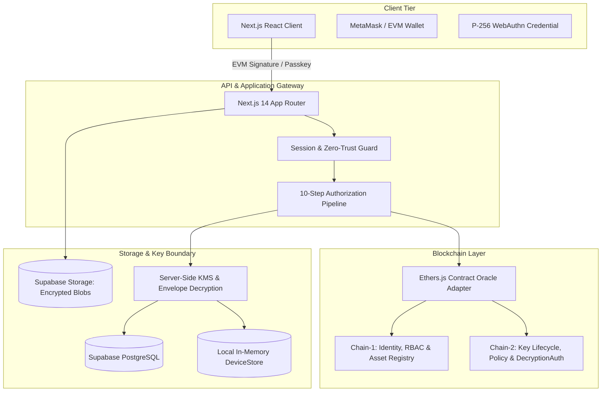

# SecureMAX Current Architecture Specification

> **Classification**: ARCHITECTURAL BASELINE (AS-IS)  
> **Date**: October 2026  
> **Repository**: `SECURE_MAX` (SIH26125)  
> **Source Verification**: Verified from source code inspection  

---

## 1. High-Level Architectural Overview

SecureMAX implements a multi-tier defense platform designed around the separation of authorization from decryption across two logical blockchain domains and an off-chain application/KMS runtime.

---

## 2. Component Deconstruction

### 2.1 Identity, Session & Credential Layer
- **Dual Authentication**:
  - **Administrators**: Authenticate via MetaMask ECDSA signature over a server-generated challenge nonce (`/api/auth/challenge`).
  - **Standard Users**: Authenticate via P-256 device credentials signed using the WebAuthn standard (`/api/auth/login`).
- **Session Representation**:
  - Upon successful challenge verification, an HTTP-only JWT cookie (`securemesh_session`) is issued.
  - The session payload contains `userId`, `role`, `sessionId`, `deviceId`, and `did`.
- **State Persistence**:
  - Primary persistent state is split between Supabase PostgreSQL and a memory-backed synchronization store (`src/lib/auth/deviceStore.ts`).

### 2.2 Blockchain Domain Separation
1. **Chain-1 (Identity & Asset Domain)**:
   - `IdentityRegistry.sol`: Registers user DIDs (`did:securemax:<address>`), status (`Active`, `Suspended`, `Revoked`), and name hashes.
   - `RBACManager.sol`: Maintains bitmask role permissions per DID.
   - `AssetRegistry.sol`: Tracks asset registrations, clearance assignments, and ownership transfers.
   - `AuditAnchor.sol`: Periodically records Merkle root batches of hash-chained audit events.
2. **Chain-2 (Key Management Domain)**:
   - `KeyPolicyManager.sol`: Manages key usage policies, types, and cryptographic conditions.
   - `KeyLifecycle.sol`: Governs key versions and state transitions (`Active`, `Rotating`, `Rotated`, `Revoked`, `Destroyed`).
   - `DecryptionAuth.sol`: Authorizes individual decryption events and records completion or denial.

### 2.3 Off-Chain Storage & KMS Layer
- **Envelope Encryption**:
  - Each digital asset is encrypted with a unique 256-bit AES-GCM Data Encryption Key (DEK).
  - The DEK is wrapped using a Key Encryption Key (KEK) derived from a Master Key via PBKDF2 with context `key_wrapping:${assetId}`.
  - Encrypted asset files are stored in Supabase Storage (`securemax-vault/assets/${assetId}`), while wrapped DEKs and metadata reside in the PostgreSQL `key_versions` table and `deviceStore`.
- **Decryption Gateway** (`/api/assets/decrypt`):
  - Consumes a temporary token issued by `authorizeAssetAccess` and streams decrypted plaintext to the authorized requester.

---

## 3. Discovered Architectural Inconsistencies & Deficiencies

1. **Dual Trust Authoritative Ambiguity**:
   - Both `supabaseAdmin` and `deviceStore` contain user, session, and asset records. When Supabase is unavailable or unconfigured, the system silently relies on `deviceStore`, creating a potential desynchronization point.
2. **Implicit Identity Grants**:
   - In `src/lib/api/access-flow.ts`, hardcoded checks automatically synthesize users and active decrypt assignments if `userId` contains `'test'` or `'user-123'` or starts with `'admin'`.
3. **Missing Atomic Token Redemption**:
   - The KMS temporary authorization token is validated on decryption, but its identifier (`jti`) is not recorded in a persistent one-time redemption ledger, allowing replay attacks within its 30-minute validity window.
4. **Fallback to Insecure Keys**:
   - `src/lib/kms/index.ts` falls back to an all-zero master key on unwrapping errors, violating fail-closed security invariants.
5. **Privileged Backend Bypass**:
   - `supabaseAdmin` uses the privileged service role key, bypassing PostgreSQL RLS entirely.
