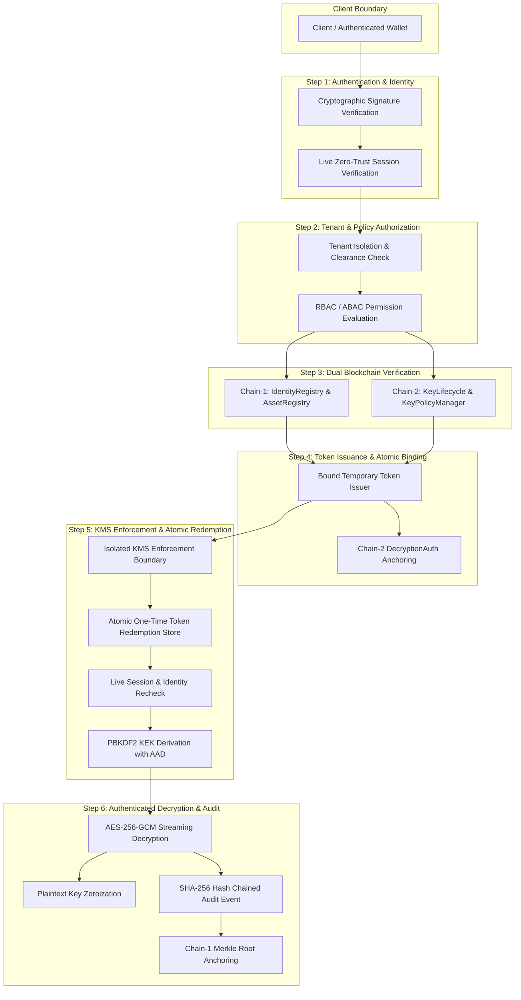

# SecureMAX Target Architecture Specification

> **Classification**: TARGET SECURITY ARCHITECTURE (TO-BE)  
> **Date**: October 2026  
> **Scope**: SecureMAX Decoupled Zero-Trust Cryptographic Enforcement Pipeline  

---

## 1. Architectural Philosophy: Canonical Decoupled Pipeline

The target architecture enforces a single canonical, tamper-resistant access and decryption pipeline that eliminates all implicit grants, predictable admin bypasses, and insecure key fallbacks.

---

## 2. Component Ownership & Decision Boundaries

| Decision / Invariant | Authoritative Component | Mechanism | Failure Mode |
| :--- | :--- | :--- | :--- |
| **User Identity & Validity** | Chain-1 `IdentityRegistry.sol` & PostgreSQL `users` | DID signature verification + live status check | Fail Closed (401 / Deny) |
| **Active Session State** | PostgreSQL `access_sessions` & `deviceStore` | Cryptographic JWT + live database session verification | Fail Closed (401 / Deny) |
| **Role & Entitlement** | Chain-1 `RBACManager.sol` | Bitmask permission verification on-chain | Fail Closed (403 / Deny) |
| **Asset Assignment & Clearance** | Chain-1 `AssetRegistry.sol` & PostgreSQL `asset_assignments` | Active assignment check; requires `can_decrypt == true` | Fail Closed (403 / Deny) |
| **Key Status & Policy** | Chain-2 `KeyLifecycle.sol` & `KeyPolicyManager.sol` | Verifies key status == `Active` and policy hash valid | Fail Closed (403 / Deny) |
| **Token Validity & Replay Defense** | KMS Enforcement Boundary | Atomic one-time token redemption table | Fail Closed (403 / Replay Denied) |
| **Cryptographic Key Release** | KMS Enforcement Boundary (`fetchAndDecryptDEK`) | PBKDF2 context KEK derivation + AES-256-GCM unwrapping | Fail Closed (No fallback key) |
| **Ciphertext Integrity** | Node.js Crypto (`decryptData`) | AES-256-GCM 128-bit authentication tag + AAD validation | Fail Closed (Throws tamper error) |
| **Audit Immutability** | Audit Logger & Chain-1 `AuditAnchor.sol` | SHA-256 hash chaining + Merkle root anchoring | Alert on integrity mismatch |

---

## 3. Key Design Enhancements

1. **Elimination of Implicit & Synthetic Grants**:
   - All synthetic mock checks (`userId.includes('test')`, `userId.startsWith('admin')`) are removed from production pathways. Tests use isolated synthetic fixtures.
2. **KMS Fail-Closed Boundary**:
   - Master Key must be a valid 64-character hex string (32 bytes). Missing or all-zero keys throw fatal errors during initialization. Decryption retries with fallback keys are eradicated.
3. **Atomic One-Time Token Redemption**:
   - Decryption authorization tokens are bound to `sub`, `assetId`, `tenantId`, `keyVersionId`, `operation: "decrypt"`, `sessionId`, `jti`, `iat`, `exp`.
   - The KMS enforcement boundary records `jti` in an atomic redemption ledger at point-of-use. Concurrent or duplicate redemptions fail immediately.
4. **Buffer Zeroization**:
   - Immediately after `createDecipheriv` consumes the plaintext DEK, `dek.fill(0)` is invoked to wipe key material from memory.
