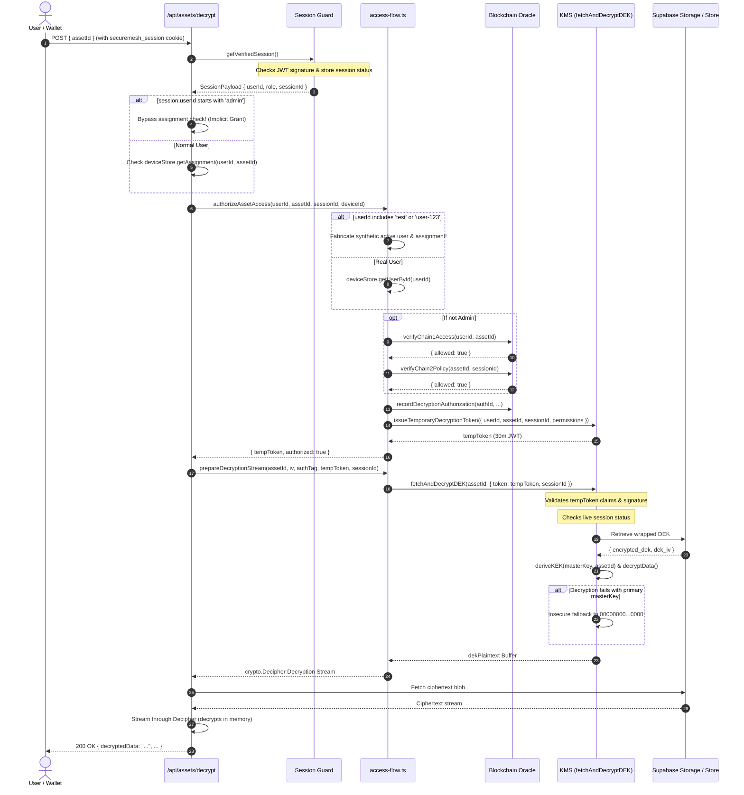

# SecureMAX Current Data Flow (As-Is)

> **Classification**: ARCHITECTURAL DATA FLOW (AS-IS)  
> **Date**: October 2026  
> **Repository**: `SECURE_MAX` (SIH26125)  

---

## 1. Endpoints Granting Access, Issuing Tokens, or Releasing Plaintext

| Endpoint / Method | Component | Capability | Current Security Enforcement | Weaknesses / Gaps |
| :--- | :--- | :--- | :--- | :--- |
| `POST /api/auth/login` | `src/app/api/auth/login/route.ts` | Issues `securemesh_session` cookie | Verifies EVM / P-256 signature against challenge | Permits fallback demo logins if demo mode enabled |
| `POST /api/access/requests` | `src/app/api/access/requests/route.ts` | Creates/Approves access requests | Requires active session; approval requires `ADMIN` or `MANAGER` | `session.role` verified, but relies on caller session state |
| `POST /api/assets/decrypt` | `src/app/api/assets/decrypt/route.ts` | **Returns Plaintext Asset Data** | Calls `authorizeAssetAccess` and `prepareDecryptionStream` | Bypasses assignment check if `session.userId?.startsWith('admin')`; no one-time token redemption |
| `authorizeAssetAccess()` | `src/lib/api/access-flow.ts` | **Issues KMS Temporary Decryption Token** | Verifies User, Device, Assignment, Chain-1, Chain-2 | Contains implicit grant for `userId.includes('test')` or `user-123`; assigns synthetic clearances |
| `fetchAndDecryptDEK()` | `src/lib/kms/index.ts` | **Releases Plaintext DEK in KMS Boundary** | Requires temporary token, checks session revocation | Silently falls back to all-zero master key on unwrap failure |

---

## 2. Complete Identity-to-Decryption Data Flow (Current)

---

## 3. Discovered Vulnerability Paths in Current Flow

1. **Adversary with `admin-` prefix**:
   If an adversary can register an identity whose ID begins with `admin`, the access flow bypasses assignment validation and Chain-1/Chain-2 contract verification.
2. **Token Replay within 30 Minutes**:
   A valid `tempToken` issued to a session can be submitted repeatedly to `fetchAndDecryptDEK` without atomic invalidation.
3. **Decryption Retry with All-Zero Key**:
   If an asset was encrypted with an improper key or a corrupted master key is loaded, KMS will attempt decryption with the all-zero key fallback.
